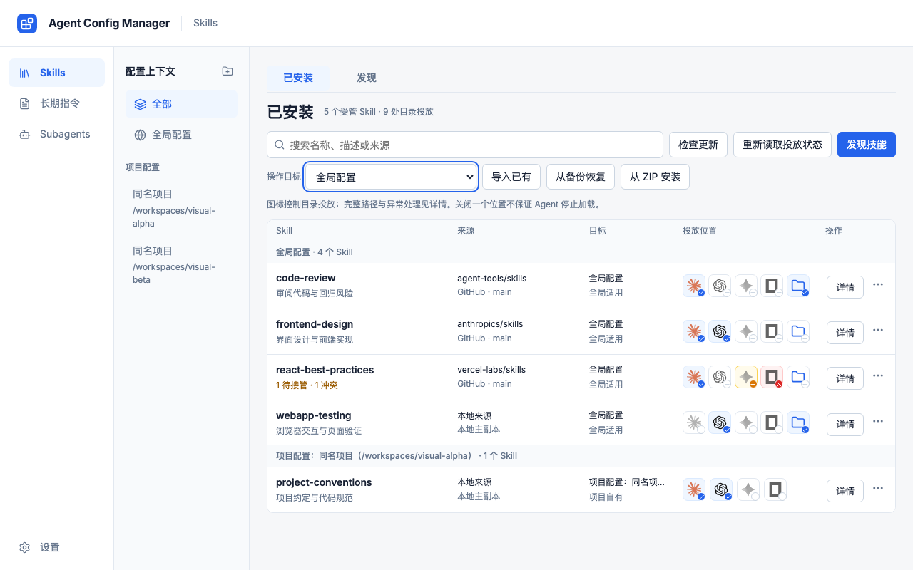

# Polished UI 验收结果

核验日期：2026-09-27。实现基线为 `cd175f4`，证据交付为 `4448ffc`；后续文档整理没有重新执行本文全部功能测试。本报告记录本地验证结果，不代表远端 CI、正式签名或发布。

实现采用[已同步的 polished 精细稿](../design/polished/README.md)，覆盖 Skills、统一 AGENTS.md、原生 Subagents、设置和对应弹窗。Skills 保留五列 64px 紧凑行、横排 32px 投放图标；390px 下采用逐层导航和横排 44px 操作区域。没有自动迁移已有用户文件。

[操作步骤与启动命令](./polished-ui.md)。`npm run accept:ui` 使用正式 App 和模拟命令，刷新恢复样例；`npm run accept:app` 使用真实 Tauri 命令与隔离目录。macOS 调试 `.app` 通过启动配置保留所选 ACM_HOME，直接重开仍保持隔离。

## 验证结果

| 检查 | 结果 | 日志 |
| --- | --- | --- |
| verify:static | 8/8 通过 | [日志](evidence/2026-09-27-polished-ui/logs/static.log) |
| test:frontend | 23 文件、213 用例通过 | [日志](evidence/2026-09-27-polished-ui/logs/frontend.log) |
| test:rust | 默认与 test-harness 各 233 通过、1 忽略 | [日志](evidence/2026-09-27-polished-ui/logs/rust.log) |
| test:ui | 7/7 测试文件通过 | [日志](evidence/2026-09-27-polished-ui/logs/ui-all.log) |
| 最终 Polished UI 复测 | 6/6 用例通过 | [日志](evidence/2026-09-27-polished-ui/logs/ui-polished.log) |
| test:tauri 离线 | 写入进程 4 用例、重启进程 1 用例通过 | [日志](evidence/2026-09-27-polished-ui/logs/tauri-revision-backup.log) |
| 在线 Tauri | 写入／在线进程 5 用例、重启进程 1 用例通过 | [日志](evidence/2026-09-27-polished-ui/logs/tauri-online.log) |
| build:frontend | 通过 | [日志](evidence/2026-09-27-polished-ui/logs/build.log) |
| accept:app | 本地调试应用构建与系统选择器实操通过 | [日志](evidence/2026-09-27-polished-ui/logs/accept-app-continued.log) |

最后两处弹窗布局调整后复跑了前端单元测试及 Polished 全套；完整 UI 七个测试文件此前已通过。之后仅调整验收启动方式和文档，重新通过静态检查并执行桌面实操。Rust 忽略项会主动读取宿主 Agent 目录，因此未在隔离验收中启用。

真实 Tauri 自动化验证了导入预览过期时的 revision 拒绝、外部修改保留、投放／撤回、统一 AGENTS.md 双路径保存、原生 Subagent 接管／编辑／备份恢复／启停，以及新进程的持久化回读。比较八个宿主关键指令／配置文件的存在状态和 SHA-256，均未变化；此结论不声称遍历整个用户目录。

在线测试单独开启：从 anthropics/skills 发现 20 项，安装 frontend-design 到 Codex，检查更新为 0 项，同源更新执行成功并读取真实文件。本次没有跨版本升级可供验证。网络结果与模拟测试分别记录。

系统界面实操验证了 ZIP 和项目文件夹的选择、取消；安装文件与样例逐字节一致，visual-alpha 登记进入隔离 SQLite。退出后直接从 macOS 重开，仍回读同一隔离目录。见[结果](evidence/2026-09-27-polished-ui/logs/native-desktop-results.json)及[窗口读回](evidence/2026-09-27-polished-ui/logs/native-restart-accessibility.txt)。

日志中的本机工作区和用户目录分别替换为 `<repo>` 与 `<home>`，并去除行末空白。Tauri 驱动有活动窗口／退出清理警告；相关断言、磁盘读回及退出码通过，后续系统界面实操已补齐选择器验收。当前没有未通过项。

## 实际界面

以下 33 张图来自正式 App 的浏览器验收入口，数据为明确标注的模拟样例；不是 Pen 导出图，也不是旧 prototype 页面。按三个尺寸逐状态检查了布局；不声称像素级完全一致。弹窗截图保留 1280×800 背景，Pen 弹窗画板尺寸只表示弹窗区域。组件与总览板仅作为参照。

| 清单截图 | Pen 节点 | 实际尺寸 |
| --- | --- | --- |
| [desktop-1586-skills-installed.png](evidence/2026-09-27-polished-ui/desktop-1586-skills-installed.png) | `jDYK3` | 1586×992 |
| [desktop-1586-skill-detail.png](evidence/2026-09-27-polished-ui/desktop-1586-skill-detail.png) | `fTYXd` | 1586×992 |
| [desktop-1586-skills-discovery.png](evidence/2026-09-27-polished-ui/desktop-1586-skills-discovery.png) | `n3HwT3` | 1586×992 |
| [desktop-1586-instructions.png](evidence/2026-09-27-polished-ui/desktop-1586-instructions.png) | `Kf5mn` | 1586×992 |
| [desktop-1586-subagents-installed.png](evidence/2026-09-27-polished-ui/desktop-1586-subagents-installed.png) | `jnkiL` | 1586×992 |
| [desktop-1586-subagents-discovery.png](evidence/2026-09-27-polished-ui/desktop-1586-subagents-discovery.png) | `iehBb` | 1586×992 |
| [desktop-1586-settings.png](evidence/2026-09-27-polished-ui/desktop-1586-settings.png) | `hQYBt` | 1586×992 |
| [desktop-1280-skills-installed.png](evidence/2026-09-27-polished-ui/desktop-1280-skills-installed.png) | `v5WGtu` | 1280×800 |
| [desktop-1280-skill-detail.png](evidence/2026-09-27-polished-ui/desktop-1280-skill-detail.png) | `is3jO` | 1280×800 |
| [desktop-1280-skills-discovery.png](evidence/2026-09-27-polished-ui/desktop-1280-skills-discovery.png) | `CgNbx` | 1280×800 |
| [desktop-1280-instructions.png](evidence/2026-09-27-polished-ui/desktop-1280-instructions.png) | `U0VocL` | 1280×800 |
| [desktop-1280-subagents-installed.png](evidence/2026-09-27-polished-ui/desktop-1280-subagents-installed.png) | `mWYdV` | 1280×800 |
| [desktop-1280-subagents-discovery.png](evidence/2026-09-27-polished-ui/desktop-1280-subagents-discovery.png) | `Ykfzl` | 1280×800 |
| [desktop-1280-settings.png](evidence/2026-09-27-polished-ui/desktop-1280-settings.png) | `Y7fLKL` | 1280×800 |
| [mobile-390-asset-types.png](evidence/2026-09-27-polished-ui/mobile-390-asset-types.png) | `yO5HX` | 390×844 |
| [mobile-390-contexts.png](evidence/2026-09-27-polished-ui/mobile-390-contexts.png) | `SDwr0` | 390×844 |
| [mobile-390-skills-installed.png](evidence/2026-09-27-polished-ui/mobile-390-skills-installed.png) | `CMdbh` | 390×844 |
| [mobile-390-skill-detail.png](evidence/2026-09-27-polished-ui/mobile-390-skill-detail.png) | `s1nGfU` | 390×844 |
| [mobile-390-install-dialog.png](evidence/2026-09-27-polished-ui/mobile-390-install-dialog.png) | `Z3j6l` | 390×844 |
| [mobile-390-settings.png](evidence/2026-09-27-polished-ui/mobile-390-settings.png) | `VmYqY` | 390×844 |
| [dialog-skill-install.png](evidence/2026-09-27-polished-ui/dialog-skill-install.png) | `ARBv7` | 1280×800 |
| [dialog-project-subagent-install.png](evidence/2026-09-27-polished-ui/dialog-project-subagent-install.png) | `lSPVk` | 1280×800 |
| [dialog-zip-install.png](evidence/2026-09-27-polished-ui/dialog-zip-install.png) | `voIeN` | 1280×800 |
| [dialog-import-existing.png](evidence/2026-09-27-polished-ui/dialog-import-existing.png) | `jT0eI` | 1280×800 |
| [dialog-backup-restore.png](evidence/2026-09-27-polished-ui/dialog-backup-restore.png) | `cBnTx` | 1280×800 |
| [mobile-390-instructions.png](evidence/2026-09-27-polished-ui/mobile-390-instructions.png) | `x0em3A` | 390×844 |
| [mobile-390-instruction-detail.png](evidence/2026-09-27-polished-ui/mobile-390-instruction-detail.png) | `J6dPZ` | 390×844 |
| [mobile-390-subagents-installed.png](evidence/2026-09-27-polished-ui/mobile-390-subagents-installed.png) | `ffOcC` | 390×844 |
| [mobile-390-subagent-detail.png](evidence/2026-09-27-polished-ui/mobile-390-subagent-detail.png) | `zP3xY` | 390×844 |
| [mobile-390-skills-actions.png](evidence/2026-09-27-polished-ui/mobile-390-skills-actions.png) | `ZpOgV` | 390×844 |
| [dialog-import-preview.png](evidence/2026-09-27-polished-ui/dialog-import-preview.png) | `Q89aqy` | 1280×800 |
| [dialog-subagent-update.png](evidence/2026-09-27-polished-ui/dialog-subagent-update.png) | `VaiMD` | 1280×800 |
| [dialog-subagent-backup.png](evidence/2026-09-27-polished-ui/dialog-subagent-backup.png) | `v2QXZ` | 1280×800 |

## 异常状态与真实桌面

系统窗口截图包含标题栏，采用 Retina 物理像素；桌面图来自真实隔离数据。

| 状态 | 截图 |
| --- | --- |
| 空态 | [查看](evidence/2026-09-27-polished-ui/state-empty.png) |
| 加载 | [查看](evidence/2026-09-27-polished-ui/state-loading.png) |
| 错误与重试 | [查看](evidence/2026-09-27-polished-ui/state-error.png) |
| 系统文件选择取消 | [查看](evidence/2026-09-27-polished-ui/native-picker-cancelled.png) |
| 系统 ZIP 文件选择器 | [查看](evidence/2026-09-27-polished-ui/native-file-picker.png) |
| 选中 ZIP 与 Codex | [查看](evidence/2026-09-27-polished-ui/native-zip-selected.png) |
| ZIP 安装成功 | [查看](evidence/2026-09-27-polished-ui/native-zip-installed.png) |
| 系统项目文件夹选择器 | [查看](evidence/2026-09-27-polished-ui/native-project-picker.png) |
| 项目添加成功 | [查看](evidence/2026-09-27-polished-ui/native-project-added.png) |
| macOS 重开回读 | [查看](evidence/2026-09-27-polished-ui/native-restart-readback.png) |
